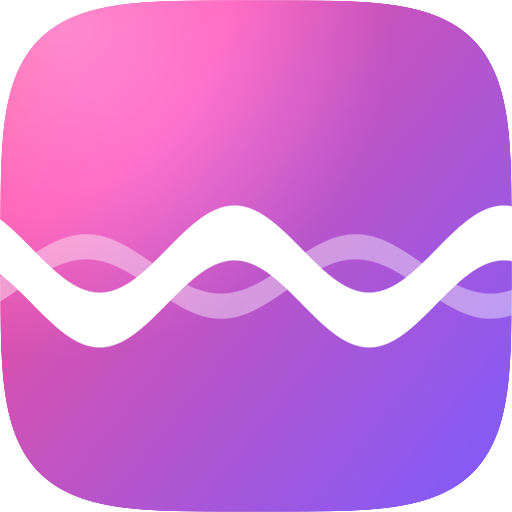
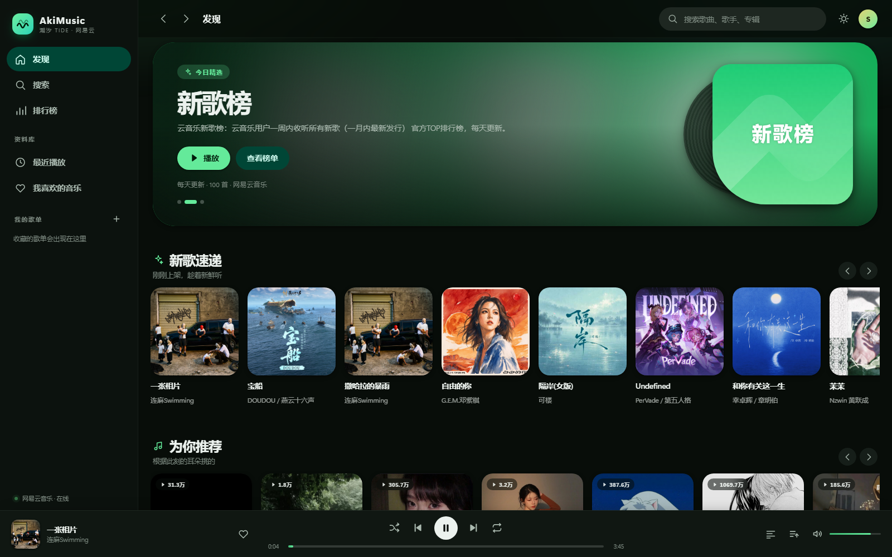
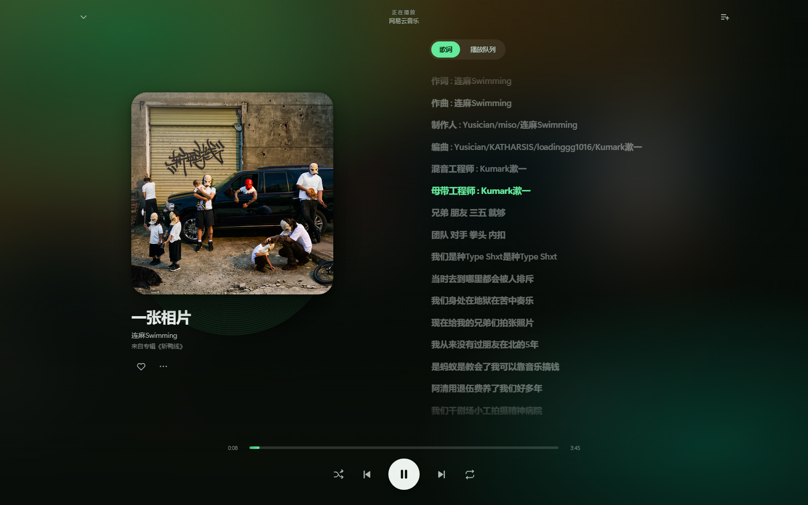
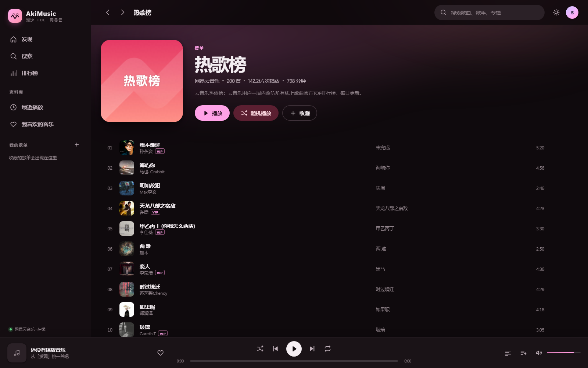
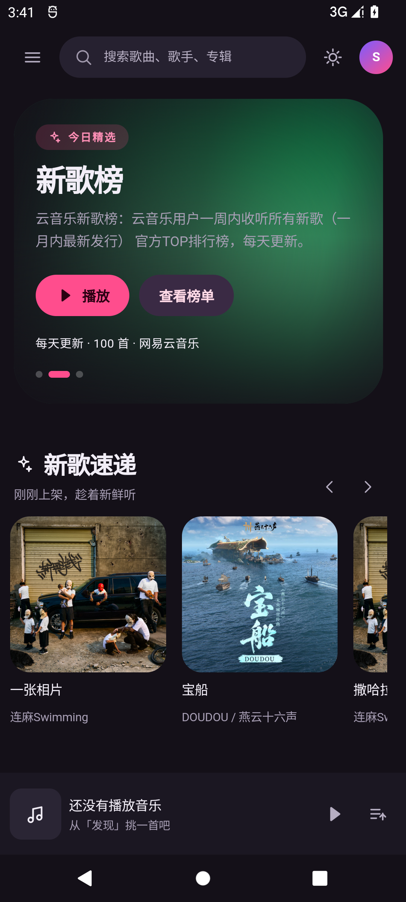
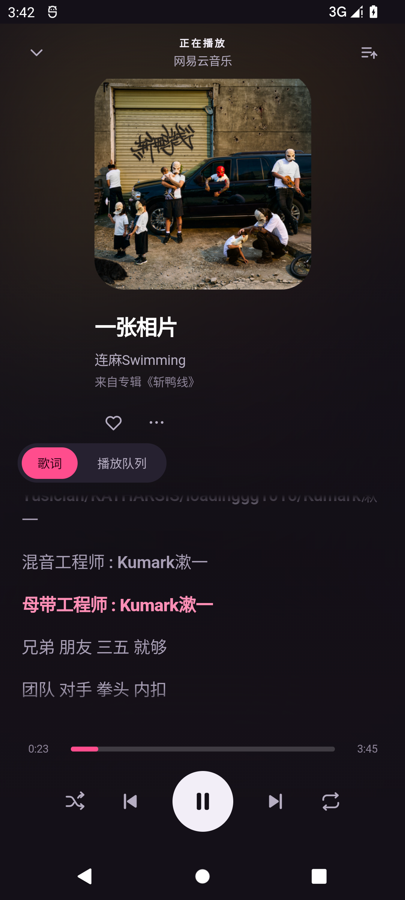

<div align="center">
  
  <h1>AkiMusic</h1>
  <p><b>潮汐 TIDE</b> — 一个 Material 3 Expressive 风格的网易云音乐播放器</p>
  <p>
    <a href="https://github.com/aki-ryo/AkiMusic/releases/latest"><b>⬇ 下载 APK</b></a>
    &nbsp;·&nbsp;
    <a href="#桌面版">桌面版</a>
    &nbsp;·&nbsp;
    <a href="#自己构建">自己构建</a>
  </p>
  <p>
    
    
    
  </p>
</div>



---

## 这是什么

一个把 **Apple Music 的信息架构** 塞进 **Material Design 3 Expressive 视觉语言** 里的音乐播放器，数据与音源来自网易云音乐。

同一套前端跑在两个地方：

- **Android**：一个 98 KB 的壳，内置本地 HTTP 服务，前端资源全部打进 APK
- **桌面 / 浏览器**：`python server.py` 起一个零依赖服务，打开网页即用

没有构建工具、没有 npm 依赖、不需要账号。

---

## 亮点

**会跟着封面变色的界面**

播放时从专辑封面提取主色（OKLab 色彩聚类），整套 MD3 色彩角色——导航高亮、按钮、进度条、光晕——一起滑向新的色相。色板用 OKLCH 写成以 `--h` / `--c` 为变量的表达式，切换有 0.9 秒缓动。

**形状会呼吸**

卡片悬停时圆角从 `24px` 变成 `26px 20px 26px 20px`，Hero 封面在 `34px` 与 `96px` 之间来回变，播放页从底部弹上来。动效曲线是带一点回弹的 `cubic-bezier(.2,1.28,.36,1)`。

**Apple Music 的骨架**

左侧资料库 → 顶栏搜索 → Hero 轮播 + 横向书架 → 底部通栏播放条 → 点封面展开全屏播放页（左封面、右歌词）。

---

## 截图

| 桌面 · 正在播放 | 桌面 · 歌单 |
| --- | --- |
|  |  |

| Android · 首页 | Android · 播放页 |
| --- | --- |
|  |  |

---

## 下载安装

到 [Releases](https://github.com/aki-ryo/AkiMusic/releases) 下载 `AkiMusic-0.1.0-beta.apk`，允许「安装未知来源应用」后安装。

- Android 8.0 (API 26) 及以上
- APK 已内置接口代理，**不需要连电脑**，装完就能播
- 建议系统 WebView 111+（2023 年之后的机型基本都满足）；旧内核会自动降级为配色兜底

## 桌面版

```bash
python server.py          # 默认 8777 端口，被占用会自动 +1
```

打开 <http://localhost:8777>。Windows 也可以直接双击 `start.bat`。

> 网易云接口不返回 CORS 头，浏览器直连会被拦，所以需要一个本地代理：`server.py` 负责静态托管、`/api/*` 转发（补 Referer/UA/Cookie、5 分钟缓存）、`/img` 图片代理（让 canvas 能读到封面像素）。

---

## 功能

- 发现页：精选轮播、继续聆听、新歌速递、推荐歌单、排行榜
- 搜索：单曲 / 歌单 / 专辑 / 歌手，边打字边出结果
- 排行榜、歌单、专辑、歌手详情
- 播放：队列、上/下一首、随机、列表循环 / 单曲循环、拖进度、音量
- 全屏播放页：封面取色、LRC 歌词逐行高亮并自动滚动、点歌词跳转
- 资料库：我喜欢的音乐、最近播放（本地保存）
- 收藏歌单：侧栏「+」粘贴链接或 ID
- 深色 / 浅色主题；移动端抽屉导航
- 快捷键：`Space` 播放/暂停、`Alt + ←/→` 切歌、`Esc` 关闭弹层

---

## 自己构建

需要 JDK 11+（推荐 17）和 Android SDK（build-tools 35 + platform android-36）。

```bash
JAVA_HOME=/path/to/jdk17 ./android/build.sh
```

脚本会：同步 `public/` 到 assets → `aapt2` 编译链接资源 → `javac` → `d8` 转 dex → `zipalign` → `apksigner` 签名，产物落在 `dist/`。

> 仓库里的 `android/keystore.jks` 是公开的测试签名（口令均为 `akimusic`），**只用来自娱自乐**；要正式发布请换成自己的证书。

---

## 结构

```
.
├─ server.py                桌面版服务：静态资源 + 网易云接口代理 + 图片代理
├─ start.bat                Windows 一键启动
├─ public/                  前端（原生 ES Module，无构建）
│  ├─ index.html
│  ├─ css/tokens.css        MD3 设计令牌：色彩角色 / 字阶 / 形状 / 动效
│  ├─ css/app.css           布局与组件
│  └─ js/{app,api,player,views,theme,store,util}.js
├─ android/
│  ├─ AndroidManifest.xml
│  ├─ build.sh              脱离 Gradle 的打包脚本
│  ├─ java/…/MainActivity.java   WebView 壳 + 返回键处理
│  ├─ java/…/AssetServer.java    内置 HTTP 服务（server.py 的 Java 版）
│  ├─ res/                  图标与主题
│  └─ tools/make_icons.py   图标生成器
├─ dist/                    签名好的 APK
└─ docs/                    截图
```

---

## 已知限制

- **VIP 曲目**：接口最多给 30 秒试听片段，界面会提示；完全没有音源的会**自动跳过**，队列不会卡死
- **后台播放**：切到后台时 WebView 音频可能被系统暂停，暂未接入前台服务
- 歌词开头的「作词/作曲/编曲」也会逐行高亮，因为 LRC 本身就带时间戳

---

## 声明

仅供学习和个人使用。音乐版权归网易云音乐及各版权方所有，请勿用于商业用途。
